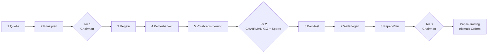

# Reverse-Engineering-Kit

**Vom Playbook, dem du vertraust, zum geprüften Regelwerk – mit einer KI-Organisation und dir als Chairman.**

[English](README.md) · [Schnellstart](docs/de/quickstart.md) · [Methodik](docs/de/methodology.md) · [Haftungsausschluss](DISCLAIMER.md)

> ⚠️ **Haftungsausschluss.** Dieses Projekt dient nur Bildungszwecken und ist keine Finanzberatung.
> **Ich übernehme keine Verantwortung für jegliche Ergebnisse, die in Verbindung mit diesem Projekt gegebenenfalls
> erzielt werden können.** Trading kann zum Totalverlust des eingesetzten Geldes führen. Das Kit kann keine Orders
> senden. Was du mit echtem Geld tust, ist deine Entscheidung und dein Risiko. Volltext: [DISCLAIMER.md](DISCLAIMER.md).

> Unabhängiges Projekt, **nicht mit EmperorBTC verbunden** und nicht von ihm empfohlen. Seine öffentlichen Inhalte
> dienen als durchgerechnetes Beispiel, zusammengefasst in eigenen Worten und mit Links zum Original.

Du folgst einem Trader, einem Buch oder deinem eigenen Playbook. Du glaubst daran. Aber hält es, wenn eine Maschine
es ohne Bauchgefühl anwendet, mit Gebühren, Slippage und der vollen Statistik des Zufalls? Mit diesem Kit findest du
es heraus: ehrlich, mathematisch fundiert und ohne selbst Code zu schreiben.

## So funktioniert es
Zwei KI-Agenten machen die Arbeit, ein dritter greift sie an, und du entscheidest an den Toren.



| Rolle | Wer | Aufgabe |
|-------|-----|---------|
| Chairman | du | GO / HOLD / NO-GO an drei Toren, Veto bei allem |
| CIO | KI-Agent | Quelle, Prinzipien, Regeln, Aufträge, Bewertungen |
| CTO | KI-Agent | kodiert die Regeln, nutzt den getesteten Kern `rekit`, liefert mit Belegen |
| Challenger | KI-Agent | greift jedes Ergebnis mit sechs Pflichtfragen an |

## Warum die Ergebnisse halten
Die Agenten schreiben keine eigene Statistik. Sie rufen `rekit` auf, einen kleinen, getesteten Kern:
- **Sperre der Vorabregistrierung:** Hypothesen und Regel-Code werden nach deinem GO eingefroren (SHA-256), geänderte Dateien
  werden abgelehnt.
- **Look-Ahead-Prüfung:** verändert die Zukunft und prüft, dass sich vergangene Signale nicht bewegen.
- **Ehrliche Ausführung:** Einstieg zur nächsten Kerze, Gebühren, Slippage, Lücken über den Stop, Stop zuerst bei
  unklaren Kerzen.
- **Statistik gegen Glück:** 1.000-fach-Bootstrap über ganze Wochen, Deflated Sharpe, Holm-Korrektur, Stärke-Analyse, Walk-Forward.
- **Konzentrations-Check:** Was bleibt ohne deine besten drei Trades?
- **Mechanisches Urteil:** ACCEPT / REJECT / HOLD je Hypothese, nach vorab festgelegten Kriterien.

Details: [Methodik](docs/de/methodology.md).

## Schnellstart
```bash
git clone https://github.com/HankRaiden/reverse-engineering-kit.git
cd reverse-engineering-kit
uv sync --extra data && uv run pytest -q
claude    # dann: /source <deine Quelle und Links>
```
Schritt für Schritt: [Schnellstart](docs/de/quickstart.md).

## Was drin ist
| Pfad | Inhalt |
|------|--------|
| `AGENTS.md`, `.claude/` | die Organisation: Rollen, Tore, 11 Ablauf-Befehle |
| `src/rekit/` | der getestete Kern (Daten, Look-Ahead-Prüfung, Backtest, Statistik, Urteile, Paper-Simulator) |
| `templates/de`, `templates/en` | 13 Vorlagen vom Quellen-Steckbrief bis zum Wochen-Review |
| `docs/de`, `docs/en` | Methodik, Organisation, 14 Anti-Muster, Lehren aus dem Live-Betrieb, Übertragbarkeit |
| `examples/beispiel-emperorbtc-oeffentlich/` | alle 8 Stufen an öffentlichen Prinzipien durchgespielt |

## Woher das kommt
Die ganze Geschichte mit allen Zahlen in Prozent: **[emperorai-v2-industry.vercel.app](https://emperorai-v2-industry.vercel.app)**.

Die Methode stammt aus einem echten Projekt. Ein Krypto-Bot wurde aus öffentlichem Trading-Wissen gebaut, von zwei
KI-Agenten geführt und von einem Menschen mit Vetorecht kontrolliert. Er handelte von Februar bis Juli 2026 mit
Eigenkapital auf Bybit. Die ganze Geschichte mit Erfolgen und Misserfolgen steht in der [Projektgeschichte](docs/de/project-history.md),
was er gelernt hat, auch was **nicht** funktionierte, in [Lehren aus dem Live-Betrieb](docs/de/lessons-from-live.md). **Der Bot selbst wird nicht veröffentlicht**
([warum](SAFETY.md)).

## Nicht nur Krypto
Jedes öffentliche Playbook, jede Strategie und jedes eigene Prinzip lässt sich übertragen, sofern die Regeln als
Wenn-Dann formulierbar sind, historische Daten existieren und der Broker eine stabile API anbietet. Siehe
[Übertragbarkeit](docs/de/transferability.md).

## Sicherheit
Das Kit kann keine Orders senden. Ein Test erzwingt das bei jedem Push. Siehe [SAFETY.md](SAFETY.md).

## Lizenz
MIT, siehe [LICENSE](LICENSE). Der Haftungsausschluss in [DISCLAIMER.md](DISCLAIMER.md) gilt für jede Nutzung.
