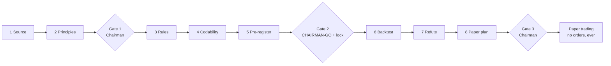

# Reverse-Engineering Kit

**From a playbook you trust to a tested rule set — with an AI organisation and you as chairman.**

[Deutsch](README.de.md) · [Quickstart](docs/en/quickstart.md) · [Methodology](docs/en/methodology.md) · [Disclaimer](DISCLAIMER.md)

> ⚠️ **Financial disclaimer.** This project is for educational purposes only and is not financial advice.
> **I accept no responsibility for any results that may be obtained in connection with this project.** Trading can
> lead to the total loss of the money used. The kit cannot place orders; anything you do with real money is your own
> decision and risk. Full text: [DISCLAIMER.md](DISCLAIMER.md).

> Independent project, **not affiliated with EmperorBTC** and not endorsed by him. His public content is used as a worked
> example, summarised in our own words with links to the original.

You follow one trader, one book, or your own playbook. You believe in it. But does it hold when a machine applies it
without gut feeling, with fees, slippage and the full statistics of chance? This kit lets you find out — honestly,
mathematically, and without writing code yourself.

## How it works
Two AI agents do the work, a third attacks it, and you decide at the gates.



| Role | Who | Job |
|------|-----|-----|
| Chairman | you | GO / HOLD / NO-GO at three gates, veto on everything |
| CIO | AI agent | source, principles, rules, assignments, reviews |
| CTO | AI agent | codes the rules, runs the tested core `rekit`, delivers with evidence |
| Challenger | AI agent | attacks every result with six mandatory questions |

## Why the results hold up
The agents do not write their own statistics. They call `rekit`, a small, tested core:
- **Pre-registration lock:** hypotheses and the rule code are frozen (SHA-256) after your GO; changed files are refused.
- **Look-ahead detector:** changes the future and checks that past signals do not move.
- **Honest execution:** next-candle fills, fees, slippage, gaps through the stop, stop-first in ambiguous candles.
- **Statistics against luck:** 1,000× bootstrap by whole weeks, deflated Sharpe, Holm correction, power analysis, walk-forward.
- **Concentration check:** what is left without your best three trades?
- **Mechanical verdict:** ACCEPT / REJECT / HOLD per hypothesis, by criteria fixed in advance.

Details: [methodology](docs/en/methodology.md).

## Quickstart
```bash
git clone https://github.com/HankRaiden/reverse-engineering-kit.git
cd reverse-engineering-kit
uv sync --extra data && uv run pytest -q
claude    # then: /source <your source and links>
```
Step by step: [quickstart](docs/en/quickstart.md).

## What is inside
| Path | Content |
|------|---------|
| `AGENTS.md`, `.claude/` | the organisation: roles, gates, 11 workflow commands |
| `src/rekit/` | the tested core (data, look-ahead check, backtest, statistics, verdicts, paper simulator) |
| `templates/en`, `templates/de` | 13 templates: source profile to weekly review |
| `docs/en`, `docs/de` | methodology, organisation, 14 anti-patterns, lessons from live trading, transferability |
| `examples/beispiel-emperorbtc-oeffentlich/` | all 8 stages worked through on public principles |

## Where this comes from
The full story, in German, with all numbers in percent: **[emperorai-v2.vercel.app](https://emperorai-v2.vercel.app)**.

The method grew out of a real project: a crypto bot built from public trading knowledge, run by two AI agents and one
human with a veto, trading its own capital on Bybit from February to July 2026. The full story, with successes and failures, is in [project history](docs/en/project-history.md); what it learned —
including what did **not** work — is in [lessons from live trading](docs/en/lessons-from-live.md). **The bot itself is not published**
([why](SAFETY.md)).

## Works beyond crypto
Any public playbook, strategy or principle of your own can be transferred, as long as the rules can be phrased as
if-then, historical data exists, and the broker offers a stable API. See [transferability](docs/en/transferability.md).

## Safety
The kit cannot send orders. A test enforces this on every push. See [SAFETY.md](SAFETY.md).

## License
MIT — see [LICENSE](LICENSE). The disclaimer in [DISCLAIMER.md](DISCLAIMER.md) applies to every use.
